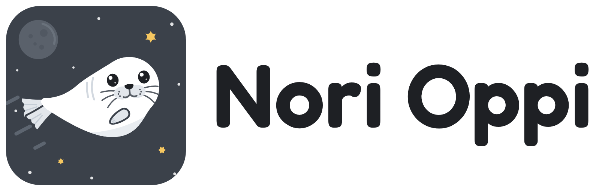

  <code>software · reverse engineering · embedded systems</code>

We're **Nori Oppi**. We build the cutest tools we can, on top of engineering we take seriously. Our first family of projects makes streaming your PC to another screen feel effortless, for desktop work and games alike.

## Projects

<table>
  <tr>
    <td width="72" align="center"></td>
    <td>
      <b><a href="https://github.com/Nori-Oppi/Norilight">Norilight</a></b> · the client 
      The cutest Moonlight client ε(　꜆´ω`)꜆ Profiles keep separate settings for gaming and desktop work, each stream opens in its own window, and you can manage a Norishine host without leaving the app. Windows and macOS.
    </td>
  </tr>
  <tr>
    <td width="72" align="center"></td>
    <td>
      <b><a href="https://github.com/Nori-Oppi/Norishine">Norishine</a></b> · the host 
      Streams your Windows PC to Norilight, Moonlight and Artemis. Virtual displays, per-device permissions, clipboard sync and a searchable settings page.
    </td>
  </tr>
  <tr>
    <td width="72" align="center"></td>
    <td>
      <b><a href="https://github.com/Nori-Oppi/norilight-common-c">norilight-common-c</a></b> · the protocol library 
      moonlight-common-c with Apollo server command support, used by Norilight.
    </td>
  </tr>
</table>

## Get started

1. Install **Norishine** on the PC you want to stream from: [latest nightly](https://github.com/Nori-Oppi/Norishine/releases).
2. Install **Norilight** on the computer you want to stream to: [latest nightly](https://github.com/Nori-Oppi/Norilight/releases).
3. Pair them and start streaming.

Both are nightly builds, released under GPL-3.0. Found a bug or have an idea? Open an issue on the project's repository.

 

  <picture>
    <source media="(prefers-color-scheme: dark)" srcset="assets/nori-oppi-lockup-horizontal-dark.png">
    
  </picture>
   
  Made in the Netherlands · <a href="https://alicevh.systems">alicevh.systems</a>

